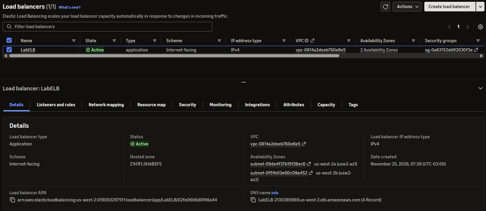
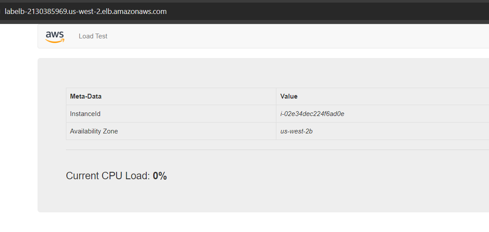

# Lab 174 - Escalando e Balanceando Carga da Sua Arquitetura

Laboratório prático da AWS sobre balanceamento de carga e escalabilidade automática de instâncias EC2, utilizando Elastic Load Balancing, EC2 Auto Scaling e Amazon CloudWatch.

## Objetivos

- Configurar um Application Load Balancer para distribuir as solicitações recebidas.
- Criar um Launch Template para padronizar a inicialização de instâncias EC2.
- Configurar um Auto Scaling Group para gerenciar a capacidade da aplicação.
- Distribuir o tráfego entre instâncias EC2.
- Utilizar métricas do Amazon CloudWatch no monitoramento e na escalabilidade.
- Executar o desafio opcional de criação de uma AMI utilizando AWS CLI.

## Serviços AWS utilizados

| Serviço | Utilização |
|---|---|
| Amazon EC2 | Hospedagem das instâncias da aplicação |
| Elastic Load Balancing | Distribuição do tráfego por meio do Application Load Balancer |
| EC2 Auto Scaling | Gerenciamento e ajuste automático da quantidade de instâncias |
| Amazon CloudWatch | Monitoramento de métricas utilizadas na escalabilidade |
| AWS CLI | Execução de operações na AWS pelo terminal, incluindo a criação de uma AMI |

## Acesso à instância durante o laboratório

A instância EC2 disponibilizada no ambiente estava em uma sub-rede privada e não possuía endereço IPv4 público. Para permitir o acesso pelo EC2 Instance Connect, realizamos os seguintes procedimentos:

1. Associamos um Elastic IP à instância EC2.
2. Identificamos a tabela de rotas associada à sub-rede.
3. Adicionamos uma rota padrão `0.0.0.0/0` direcionada ao Internet Gateway.
4. Acessamos a instância pelo EC2 Instance Connect utilizando o usuário `ec2-user`.

Também foram testadas outras alternativas:

- **AWS Systems Manager Session Manager:** não foi possível estabelecer uma sessão.
- **EC2 Instance Connect Endpoint:** a criação do endpoint foi bloqueada pelas permissões IAM do laboratório.
- **EC2 Serial Console:** indisponível pelas permissões do ambiente.

Essa configuração foi uma solução de acesso utilizada especificamente no laboratório temporário. A associação de um endereço público e a alteração da rota foram necessárias para esse método de conexão, mas não representam uma recomendação de arquitetura para ambientes de produção.

## Evidências do laboratório

### 1. Application Load Balancer

Visualização do Application Load Balancer `LabELB` no console do Amazon EC2, demonstrando:

- Estado do Load Balancer como **Active**.
- Nome DNS disponibilizado para acesso à aplicação.
- Zonas de disponibilidade associadas ao balanceador.

Essa configuração permite receber as solicitações dos usuários e encaminhá-las aos destinos registrados, distribuindo o tráfego da aplicação.

### 2. Auto Scaling Group

Visualização do grupo `Lab Auto Scaling Group`, demonstrando os parâmetros de capacidade configurados:

- Capacidade desejada: **2 instâncias**.
- Capacidade mínima: **2 instâncias**.
- Capacidade máxima: **4 instâncias**.

O grupo gerencia as instâncias EC2 de acordo com os limites definidos, permitindo ajustar a capacidade da aplicação conforme as políticas de escalabilidade configuradas.

### 3. Aplicação acessada pelo Load Balancer

Acesso à aplicação **Load Test** por meio do endereço DNS do Application Load Balancer.

Essa evidência demonstra que o balanceador está acessível pelo navegador e que as solicitações estão sendo encaminhadas para a aplicação disponibilizada nas instâncias EC2.

### 4. Desafio opcional - Criação de AMI utilizando AWS CLI

Como atividade complementar, realizamos a criação de uma Amazon Machine Image (AMI) diretamente pelo terminal da instância EC2, utilizando o AWS CLI.

**Etapas executadas:**

1. Verificamos a instalação do AWS CLI por meio do comando `aws --version`.
2. Configuramos as credenciais temporárias fornecidas pelo ambiente do laboratório no arquivo `~/.aws/credentials` da instância EC2.
3. Executamos `aws sts get-caller-identity` para confirmar a identidade e validar o acesso à conta AWS.
4. Utilizamos o comando `aws ec2 create-image` para criar uma imagem da instância EC2 identificada como `i-02e34dec224f6ad0e`.
5. Definimos o nome `Lab174-AMI-Bruno` e a descrição `AMI criada via AWS CLI - Lab 174`.
6. Consultamos o estado da imagem utilizando `aws ec2 describe-images`, informando seu identificador.

**Resultado obtido:**

| Informação | Resultado |
|---|---|
| Instância de origem | `i-02e34dec224f6ad0e` |
| Identificador da AMI | `ami-03ac6f6cd84c06860` |
| Nome da imagem | `Lab174-AMI-Bruno` |
| Estado final | `available` |

A criação da AMI foi concluída com sucesso. Inicialmente, a imagem passou pelo estado `pending` durante o processamento e, posteriormente, atingiu o estado `available`, indicando que estava disponível para utilização.

Esse desafio permitiu praticar a configuração de credenciais temporárias, a validação de identidade com AWS STS e a execução de operações do Amazon EC2 por meio da linha de comando.

## Página de estudo

A página complementar contém 8 flashcards interativos para revisar os principais conceitos e serviços utilizados neste laboratório.

**[Acessar página de estudo](https://brunogacarvalho.github.io/lab-174-escalando-balanceando-carga/)**

## Créditos

Laboratório realizado durante a formação em Computação em Nuvem (AWS re/Start) da **Escola da Nuvem**.

- Professor: [Raphael Ohlsen](https://br.linkedin.com/in/raphael-ohlsen)
- Instituição: [Escola da Nuvem](https://escoladanuvem.org/) | [LinkedIn da Escola da Nuvem](https://www.linkedin.com/school/escola-da-nuvem/)

Laboratório realizado como parte da formação em Computação em Nuvem AWS.
