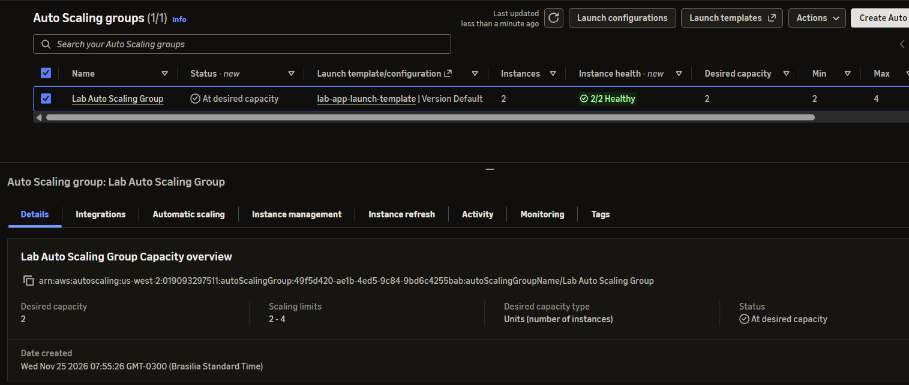
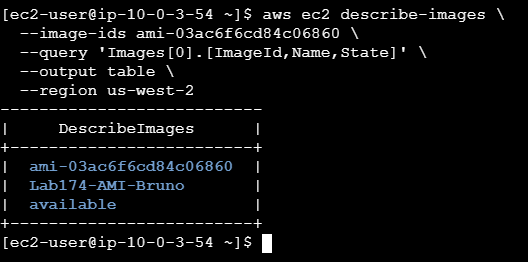
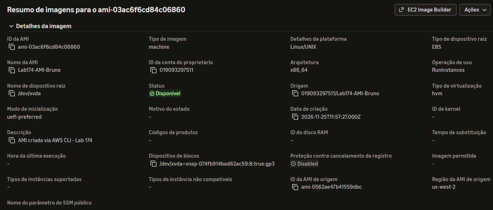

# Lab 11 - Lab 174 - Escalando e Balanceando Carga da Sua Arquitetura

Laboratório prático da AWS sobre balanceamento de carga e escalabilidade automática de instâncias EC2, utilizando Elastic Load Balancing, EC2 Auto Scaling e Amazon CloudWatch.

## Objetivos

- Configurar um Application Load Balancer para distribuir as solicitações recebidas.
- Criar um Launch Template para padronizar a inicialização de instâncias EC2.
- Configurar um Auto Scaling Group para gerenciar a capacidade da aplicação.
- Distribuir o tráfego entre instâncias EC2.
- Utilizar métricas do Amazon CloudWatch no monitoramento e na escalabilidade.
- Executar o desafio opcional de criação de uma AMI utilizando AWS CLI.

## Serviços AWS utilizados

| Serviço | Utilização |
|---|---|
| Amazon EC2 | Hospedagem das instâncias da aplicação |
| Elastic Load Balancing | Distribuição do tráfego por meio do Application Load Balancer |
| EC2 Auto Scaling | Gerenciamento e ajuste automático da quantidade de instâncias |
| Amazon CloudWatch | Monitoramento de métricas utilizadas na escalabilidade |
| AWS CLI | Execução de operações na AWS pelo terminal, incluindo a criação de uma AMI |

## Evidências do laboratório

### 1. Application Load Balancer

Application Load Balancer `LabELB` no console do Amazon EC2, apresentando:

- Estado do Load Balancer: **Active**.
- Nome DNS disponibilizado para acesso à aplicação.
- Zonas de disponibilidade associadas ao balanceador.

O balanceador recebe as solicitações dos usuários e as encaminha aos destinos registrados, distribuindo o tráfego da aplicação.

### 2. Auto Scaling Group

Grupo `Lab Auto Scaling Group`, com os seguintes parâmetros de capacidade:

- Capacidade desejada: **2 instâncias**.
- Capacidade mínima: **2 instâncias**.
- Capacidade máxima: **4 instâncias**.

O grupo gerencia as instâncias EC2 conforme os limites definidos, permitindo ajustar a capacidade da aplicação de acordo com as políticas de escalabilidade configuradas.

### 3. Aplicação acessada pelo Load Balancer

Aplicação **Load Test** acessada por meio do endereço DNS do Application Load Balancer.

A evidência demonstra a disponibilidade do balanceador e o encaminhamento das solicitações para a aplicação hospedada nas instâncias EC2.

### 4. Desafio opcional - Criação de AMI utilizando AWS CLI

Como atividade complementar, foi realizada a criação de uma Amazon Machine Image (AMI) diretamente pelo terminal de uma instância EC2, utilizando o AWS CLI.

**Preparação do acesso à instância**

A instância utilizada no desafio estava em uma sub-rede privada e não possuía endereço IPv4 público. Para viabilizar o acesso pelo EC2 Instance Connect, foram necessárias as seguintes alterações:

1. Associação de um Elastic IP à instância EC2.
2. Identificação da tabela de rotas associada à sub-rede.
3. Adição de uma rota padrão `0.0.0.0/0` direcionada ao Internet Gateway.
4. Acesso à instância pelo EC2 Instance Connect, utilizando o usuário `ec2-user`.

Também foram testadas outras alternativas de acesso:

- **AWS Systems Manager Session Manager:** não foi possível estabelecer uma sessão.
- **EC2 Instance Connect Endpoint:** a criação foi bloqueada pelas permissões IAM do laboratório.
- **EC2 Serial Console:** indisponível pelas permissões do ambiente.

Essas alterações foram realizadas exclusivamente para viabilizar o desafio no ambiente temporário e não representam uma recomendação de arquitetura para ambientes de produção.

**Etapas executadas**

1. Consulta das credenciais temporárias disponibilizadas no painel **AWS Details** do laboratório.
2. Configuração do acesso à conta AWS no terminal da instância EC2, utilizando as credenciais fornecidas.
3. Execução do comando `aws sts get-caller-identity` para verificar a identidade associada às credenciais e validar o acesso à conta.
4. Criação de uma imagem da instância EC2 `i-02e34dec224f6ad0e` por meio do comando `aws ec2 create-image`.
5. Definição do nome `Lab174-AMI-Bruno` e da descrição `AMI criada via AWS CLI - Lab 174`.
6. Consulta do estado da imagem por meio do comando `aws ec2 describe-images`.

**Resultado obtido**

| Informação | Resultado |
|---|---|
| Instância de origem | `i-02e34dec224f6ad0e` |
| Identificador da AMI | `ami-03ac6f6cd84c06860` |
| Nome da imagem | `Lab174-AMI-Bruno` |
| Estado final | `available` |

A criação da AMI foi concluída com sucesso. Inicialmente, a imagem passou pelo estado `pending` durante o processamento e, posteriormente, atingiu o estado `available`, indicando que estava disponível para utilização.

Resumo e detalhes da imagem **Lab174-AMI-Bruno** no console do Amazon EC2, confirmando a descrição definida via CLI e o status **Disponível** na região `us-west-2`.

A atividade complementar permitiu explorar a configuração de credenciais temporárias, a validação de identidade com AWS STS e a criação e consulta de imagens EC2 por meio do AWS CLI.

## Página de estudo

A página complementar contém 8 flashcards interativos para revisar os principais conceitos e serviços utilizados neste laboratório.

**[Acessar página de estudo](https://brunogacarvalho.github.io/lab-174-escalando-balanceando-carga/)**

## Créditos

Laboratório realizado durante a formação em Computação em Nuvem (AWS re/Start) da **Escola da Nuvem**.

- Professor: [Raphael Ohlsen](https://br.linkedin.com/in/raphael-ohlsen)
- Instituição: [Escola da Nuvem](https://escoladanuvem.org/) | [LinkedIn da Escola da Nuvem](https://www.linkedin.com/school/escola-da-nuvem/)

Laboratório realizado como parte da formação em Computação em Nuvem AWS.
